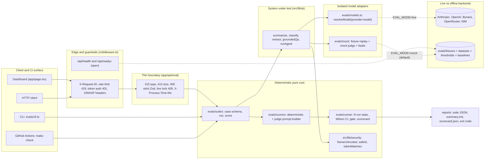

# Architecture

How the harness is layered, how a run moves through it, and where each design rule is enforced.
Commands and invariants: [AGENTS.md](AGENTS.md). Threat model: [SECURITY.md](SECURITY.md).

## Design rules

1. **Decisions in code, not prompts.** Thresholds, flake budgets, regression checks and scorecard
   metrics live in `evals/runner`, `evals/scorers` and `evals/thresholds.json`. A model output
   never decides whether the gate passes; the judge returns a 1-5 score and code applies the bar.
2. **One feature, two backends.** Every feature in `src/lib/ai/` takes a `LanguageModel`. The
   runner passes either a fixture-replay mock (default, offline, deterministic) or a real provider.
3. **Offline by default.** CI, unit and integration tests and the Docker image run without keys.
   Live mode is opt-in (`EVAL_MODE=live`) and gated again over HTTP.
4. **Immutable contracts.** Report, case, run and gate types are `readonly`; code builds new objects.
5. **Defense in depth at the edge.** Middleware, route validation and prompt framing each stop a
   different class of input. See SECURITY.md.

### Layered system architecture



### End-to-end request sequence

```mermaid
sequenceDiagram
    autonumber
    actor C as Client
    participant MW as middleware.ts
    participant R as POST /api/eval
    participant X as executeSuite
    participant M as Model (fixture or live)
    participant S as Scorers + judge
    participant G as Runner, gate, scorecard
    participant FS as reports/

    rect rgb(235, 242, 255)
    Note over C,MW: Edge guardrails
    C->>MW: POST /api/eval with JSON body
    MW->>MW: Request id, sliding-window rate limit, optional token check
    alt over limit or bad token
        MW-->>C: 429 with Retry-After 60, or 401
    end
    MW->>R: Forward with X-Request-ID
    R->>R: Content-Type 415, byte cap 413, strict Zod 400
    end

    rect rgb(236, 248, 238)
    Note over R,G: Deterministic eval run
    R->>X: suite, runs, mode
    loop each case, N runs
        X->>M: Feature prompt with untrusted text framed
        M-->>X: Text, object or tool calls
        X->>S: Score output (code checks, then judge if needed)
        S-->>X: ScoreResult list
    end
    X->>G: Pass rate, Wilson CI, flaky cases, latency
    G->>FS: safeId suite JSON
    end

    R-->>C: 200 summary with X-Process-Time-Ms and OWASP headers

## Module map

| Layer | Path | Side effects |
|---|---|---|
| Edge | `middleware.ts`, `src/lib/security/http.ts` | Process-local rate-limit table only |
| Boundary | `app/api/{eval,health,readyz}/route.ts` | Writes `reports/<suite>.json` |
| Pure core | `evals/scorers`, `evals/runner/{stats,gate,scorecard,markdown}.ts`, `src/lib/security/sanitize.ts` | None |
| Orchestration | `evals/runner/{execute,runner,load}.ts`, `evals/cli.ts` | File reads and writes |
| System under test | `src/lib/ai/*.ts` | Model calls only |
| Adapters | `evals/models.ts`, `evals/mock/*` | Network (live only) |

## Metrics

The runner records every run's latency and every scorer's verdict. `evals/runner/scorecard.ts`
derives the headline numbers from those results:

| Metric | Source |
|---|---|
| Pass rate | Mean of suite pass rates (a run passes only if every scorer passes) |
| Citation recall (Recall@k) | `rag` `citations` scorer: share of expected doc ids returned |
| Grounding rate | `rag` `judge:faithfulness` pass rate |
| Guardrail pass rate | `rag` `abstention` + `no-citations`: abstains when documents lack the answer |
| Tool-call accuracy | `agent` `tool-calls` scorer |
| Latency p50 / p95 | Nearest-rank percentiles over non-infra runs |

In mock mode latency measures the harness, not a model. Use live-mode numbers for model quality.
