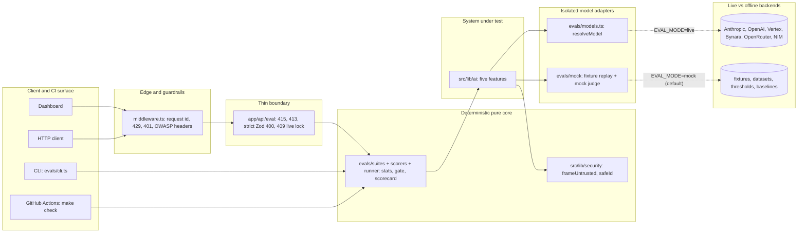
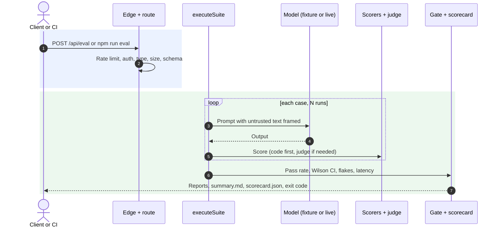

# PLANNING.md — ai-sdk-eval-harness

Source of truth for goals, scope, milestones and known gaps. README, ARCHITECTURE.md, AGENTS.md and
CLAUDE.md must not contradict this file. Change it in the same commit as any change to scope,
architecture or milestones.

Status: **v0.2.0** (2026-11-18), branch `chore/showcase`.

## 1. Goal

Show, in one small repo, how to test LLM features the way you test ordinary code: versioned golden
datasets, deterministic scorers plus a calibrated LLM judge, N-run flake detection with Wilson
intervals, and a code-defined CI gate that fails on regressions. Portfolio project, not a
production service.

## 2. Scope

In scope:
- Five Vercel AI SDK v6 features under test: `summarize`, `classify`, `extract`, `rag`, `agent`.
- Offline, deterministic mock mode (default) and opt-in live mode across `anthropic`, `openai`,
  `bynara`, `openrouter`, `nim` and `vertex`.
- Gate: pass rate, flake rate, infra-error rate and baseline regression, from `evals/thresholds.json`.
- Scorecard: pass rate, citation recall, grounding rate, guardrail pass rate, tool-call accuracy,
  p50/p95 latency.
- Next.js dashboard and a hardened `POST /api/eval` with health and readiness probes.

Non-goals:
- Model benchmarking. Six cases per suite at N=3 to 5 is a smoke test, not a leaderboard.
- Multi-instance deployment. The rate limiter is process-local.
- Persistent storage or user accounts. Reports are files under `reports/`.
- Prompt optimization. The harness measures prompts; it does not tune them.

## 3. Architecture

Detail and module map: [ARCHITECTURE.md](ARCHITECTURE.md). Threat model: [SECURITY.md](SECURITY.md).

## 4. Definition of done (every change)

1. `make check` is green: lint (0 warnings), typecheck, tests with the per-file 80% coverage gate,
   gate self-test, offline eval gate.
2. AGENTS.md invariants hold (decisions in code, offline default, `frameUntrusted`, `safeId`,
   `readonly` contracts, dataset version bumps).
3. Docs agree with this file: provider list, scorecard numbers, diagrams, commands.
4. CHANGELOG `[Unreleased]` updated; graph refreshed with `graphify update .`.

## 5. Milestones

| Version | Status | Content |
|---|---|---|
| 0.1.0 | Done | Five suites, scorers, judge, N-run flakes, Wilson CI, baseline gate, calibration, self-test, dashboard, CI |
| 0.2.0 | Done | API edge hardening, scorecard, per-file coverage gate, Docker, CodeQL, SBOM, SHA-pinned actions, `vertex:` provider, two-vendor live run |
| 0.3.0 | Planned | Close the gaps in section 6 that are marked 0.3.0 |

## 6. Known gaps and backlog

| # | Gap | Impact | Plan | Target |
|---|---|---|---|---|
| 1 | `live-eval.yml` has no Google auth step | `vertex:` runs locally only, not in Actions | Add `google-github-actions/auth` with Workload Identity Federation, SHA-pinned | 0.3.0 |
| 2 | Six cases per suite | One case moves a suite by about 17 points | Grow each dataset to 15 or more cases; bump versions in `manifest.json`; re-baseline | 0.3.0 |
| 3 | Judge calibration has 20 labels, kappa CI 0.34 to 1.0 | Judge agreement is weakly established | Add borderline labels (scores 3 to 4) until the CI lower bound is 0.5 or higher | 0.3.0 |
| 4 | Live runs used different judges and dates | The two vendors are not compared like for like | Re-run both models with one judge on the same day | 0.3.0 |
| 5 | README scorecard numbers are copied by hand from `reports/` | Docs drift (mock latency already differs run to run) | Generate the table from `scorecard.json`, or state ranges | Backlog |
| 6 | Rate limiter is process-local | Limits do not hold across replicas | Document only; a shared store is a non-goal | Won't do |
| 7 | Dashboard Run button sends no token | The button fails when `API_AUTH_TOKEN` is set | Intended for headless deployments; documented in CLAUDE.md | Won't do |

## 7. Risks

- Provider SDK churn (AI SDK v6, Gemini thought signatures): pin versions, let Dependabot raise PRs,
  and run `make check` plus one live run before merging a provider bump.
- Live-mode cost: live eval is `workflow_dispatch` only and never cancels a run in progress.
- Seeded failures (`summarize/s05`, `extract/e04`, `rag/r06`, `classify/c06`) are asserted in unit
  and e2e tests. Change them together.
