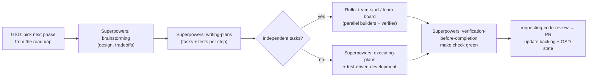

# Planning — ai-sdk-eval-harness

How work is planned here, what is open, and how the global engineering rules map onto a
TypeScript repo. Architecture diagrams live in [ARCHITECTURE.md](ARCHITECTURE.md) and the
[README](README.md#architecture); this file is the roadmap and the process.

## Planning workflow: GSD → Superpowers → Ruflo

Every non-trivial change (new suite, new provider, gate or security change) goes through three
layers. Trivial fixes (typo, one-line bug with a test) skip straight to step 4.

| Layer | Tool | Owns | Output |
|---|---|---|---|
| Roadmap | **GSD** (Get Shit Done) | Milestones and phases: what ships, in what order | `.planning/` (roadmap, state), mirrored in the backlog below |
| Task plan | **Superpowers** | Design and the step-by-step plan for one phase | `superpowers:brainstorming` → `superpowers:writing-plans` |
| Execution | **Ruflo** (Ai Team) | Splitting a plan into parallel, independently verifiable tasks | `/team-start`, `/team-board`, `/team-review` |



Rules that do not change with the tool:
1. The plan names the files, the tests and the acceptance check (`make check`, plus any eval).
2. Pass/fail logic stays in code (`evals/`), never in a plan, a prompt or model output.
3. Ruflo builders work on disjoint files; the verifier runs `make check` before anything merges.
4. Live-model runs spend tokens: a plan that needs one says so and gets approval first.

Superpowers and Ruflo are Claude Code plugins (Anthropic plugin directory). GSD is installed
locally (it is not in the directory). Graphify also runs locally. In a cloud session without
them, follow the same steps by hand and record the result in the backlog.

## Backlog

Status: ✅ done · 🔄 in progress · ⏳ blocked · 📋 planned

| # | Item | Status | Acceptance |
|---|---|---|---|
| 1 | Five suites, golden datasets, mock replay, N-run flaky detection, CI gate | ✅ | `make check` green |
| 2 | Providers: anthropic, openai, bynara, openrouter, nim | ✅ | `tests/unit/models.test.ts` |
| 3 | Eval rigor: Wilson CIs, baselines, quarantine, infra-error budget, gate self-test, judge calibration | ✅ | `eval:selftest`, `eval:calibrate` |
| 4 | API edge hardening (401/413/415/429, OWASP headers, untrusted framing) | ✅ | `tests/integration/{api,middleware}.test.ts` |
| 5 | Agent-instruction parity (AGENTS/GEMINI/CLAUDE, rules, skills), per-file coverage gate at 95% | ✅ | every file ≥ 95% lines/branches/functions |
| 6 | First live run on NVIDIA NIM (`nim:nvidia/nemotron-3-ultra-550b-a55b`) | ⏳ | needs the `NVIDIA_API_KEY` repo secret, then the `Live eval` workflow, summarize N=1 → all suites N=3 |
| 7 | Capability matrix: which live models support structured output (classify/extract/rag) and tool calling (agent) | 📋 | table in README "Live mode" |
| 8 | Diagnose live `summarize/s02`, `s04` failures (OpenRouter run: mean 0.89, 50% pass) | 📋 | scorer or dataset fix with a test, or quarantine with a reason |
| 9 | Live judge calibration (κ ≥ 0.6, within±1 ≥ 0.8) | 📋 | `EVAL_MODE=live npm run eval:calibrate` exits 0 |
| 10 | Live baseline (`evals/baselines/live.json`) via the `rebaseline` skill | 📋 | committed after items 6–9 |
| 11 | Branch protection: require `checks`, `e2e`, `docker` | 📋 | repo settings (owner) |
| 12 | Refresh the graphify knowledge graph after each merged phase | 🔄 | `graphify-out/` regenerated locally and committed |

## Global rules → TypeScript equivalents

The global standards are written for Python services. This repo applies them as follows.

| Global rule | Here |
|---|---|
| `uv run pytest`, markers `unit` / `integration` / `live` | Vitest: `tests/unit`, `tests/integration`; live paths only under `EVAL_MODE=live` |
| Offline mocks (`*_MOCK=1`) | `EVAL_MODE=mock` (default): fixture-replay model + mock judge |
| `--cov-fail-under` | Per-file 95% gate in `vitest.config.ts` (`npm run test:coverage`) |
| Ruff `S` (bandit) | `eslint-plugin-security`, 0 warnings allowed |
| Pydantic `frozen=True` | `readonly` contracts + Zod `.strict()` at the API boundary |
| Pure deterministic core | `evals/scorers`, `evals/runner`, `src/lib/security` (no I/O, no env) |
| `uv` Dockerfile, UID 10001 | Multi-stage `node:22-alpine`, `USER 10001`, `HEALTHCHECK` |

## Local-only steps (run after `git pull`)

```bash
# graphify: refresh graphify-out/ (GRAPH_REPORT.md, graph.json, graph.html), then commit it
# GSD: update phase state in .planning/ after a phase merges
```
