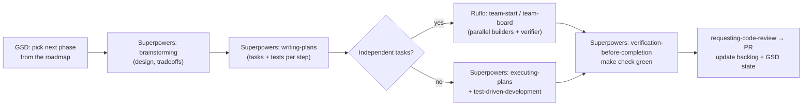

# PLANNING.md — ai-sdk-eval-harness

Source of truth for goals, scope, the planning workflow, the backlog and known gaps. README,
ARCHITECTURE.md, AGENTS.md and CLAUDE.md must not contradict this file. Change it in the same
commit as any change to scope, architecture or the backlog.

Status: **v0.2.0** (2026-11-19).

## 1. Goal

Show, in one small repo, how to test LLM features the way you test ordinary code: versioned golden
datasets, deterministic scorers plus a calibrated LLM judge, N-run flake detection with Wilson
intervals, and a code-defined CI gate that fails on regressions. Portfolio project, not a
production service.

## 2. Scope

In scope:
- Five Vercel AI SDK v6 features under test: `summarize`, `classify`, `extract`, `rag`, `agent`.
- Offline, deterministic mock mode (default) and opt-in live mode across `anthropic`, `openai`,
  `vertex`, `bynara`, `openrouter` and `nim`.
- Gate: pass rate, flake rate, infra-error rate and baseline regression, from `evals/thresholds.json`.
- Scorecard: pass rate, citation recall, grounding rate, guardrail pass rate, tool-call accuracy,
  p50/p95 latency.
- Next.js dashboard and a hardened `POST /api/eval` with health and readiness probes.

Non-goals:
- Model benchmarking. Six cases per suite at N=3 to 5 is a smoke test, not a leaderboard.
- Multi-instance deployment. The rate limiter is process-local.
- Persistent storage or user accounts. Reports are files under `reports/`.
- Prompt optimization. The harness measures prompts; it does not tune them.

## 3. Architecture

The layered flowchart and the request sequence diagram live in [ARCHITECTURE.md](ARCHITECTURE.md)
and the [README](README.md#architecture). They are not copied here, so there is one copy to keep
current. Threat model: [SECURITY.md](SECURITY.md).

## 4. Planning workflow: GSD → Superpowers → Ruflo

Every non-trivial change (new suite, new provider, gate or security change) goes through three
layers. Trivial fixes (typo, one-line bug with a test) skip straight to verification.

| Layer | Tool | Owns | Output |
|---|---|---|---|
| Roadmap | **GSD** (Get Shit Done) | Milestones and phases: what ships, in what order | `.planning/` (roadmap, state), mirrored in the backlog below |
| Task plan | **Superpowers** | Design and the step-by-step plan for one phase | `superpowers:brainstorming` → `superpowers:writing-plans` |
| Execution | **Ruflo** (Ai Team) | Splitting a plan into parallel, independently verifiable tasks | `/team-start`, `/team-board`, `/team-review` |



Rules that do not change with the tool:
1. The plan names the files, the tests and the acceptance check (`make check`, plus any eval).
2. Pass/fail logic stays in code (`evals/`), never in a plan, a prompt or model output.
3. Ruflo builders work on disjoint files; the verifier runs `make check` before anything merges.
4. Live-model runs spend tokens: a plan that needs one says so and gets approval first.

Superpowers and Ruflo are Claude Code plugins (Anthropic plugin directory). GSD is installed
locally (it is not in the directory). Graphify also runs locally. In a cloud session without
them, follow the same steps by hand and record the result in the backlog.

## 5. Definition of done (every change)

1. `make check` is green: lint (0 warnings), typecheck, tests with the per-file 95% coverage gate,
   gate self-test, offline eval gate.
2. AGENTS.md invariants hold (decisions in code, offline default, `frameUntrusted`, `safeId`,
   `readonly` contracts, dataset version bumps).
3. Docs agree with this file: provider list, scorecard numbers, diagrams, commands.
4. CHANGELOG `[Unreleased]` updated; graph refreshed with `graphify update .`.

## 6. Milestones

| Version | Status | Content |
|---|---|---|
| 0.1.0 | Done | Five suites, scorers, judge, N-run flakes, Wilson CI, baseline gate, calibration, self-test, dashboard, CI |
| 0.2.0 | Done | API edge hardening, scorecard, per-file coverage gate (95%), Docker, CodeQL, SBOM, SHA-pinned actions, `vertex:` provider, two-vendor live run |
| 0.3.0 | Planned | Backlog items marked 0.3.0 |

## 7. Backlog and known gaps

Status: ✅ done · 🔄 in progress · ⏳ blocked · 📋 planned · ➖ won't do

| # | Item | Status | Target | Acceptance |
|---|---|---|---|---|
| 1 | Five suites, golden datasets, mock replay, N-run flaky detection, CI gate | ✅ | 0.1.0 | `make check` green |
| 2 | Providers: anthropic, openai, vertex, bynara, openrouter, nim | ✅ | 0.2.0 | `tests/unit/models.test.ts` |
| 3 | Eval rigor: Wilson CIs, baselines, quarantine, infra-error budget, gate self-test, judge calibration | ✅ | 0.1.0 | `eval:selftest`, `eval:calibrate` |
| 4 | API edge hardening (401/413/415/429, OWASP headers, untrusted framing) | ✅ | 0.2.0 | `tests/integration/{api,middleware}.test.ts` |
| 5 | Agent-instruction parity (AGENTS/GEMINI/CLAUDE, rules, skills), per-file coverage gate at 95% | ✅ | 0.2.0 | every file ≥ 95% lines/branches/functions |
| 6 | Branch protection on `main`: CI, Playwright, container build, CodeQL required | ✅ | 0.2.0 | `gh api .../branches/main/protection` |
| 7 | Grow each dataset from 6 to 15+ cases (one case now moves a suite ~17 points); bump `manifest.json`; re-baseline | 📋 | 0.3.0 | `make check` green, new versions in `manifest.json` |
| 8 | `vertex:` in Actions: `google-github-actions/auth` with Workload Identity Federation in `live-eval.yml`, SHA-pinned | ⏳ | 0.3.0 | needs a GCP workload identity pool and service account (owner) |
| 9 | Judge calibration: add borderline labels (scores 3–4) until the kappa CI lower bound is ≥ 0.5 (now 0.34–1.0 on 20 labels); live κ ≥ 0.6, within±1 ≥ 0.8 | 📋 | 0.3.0 | `EVAL_MODE=live npm run eval:calibrate` exits 0 |
| 10 | Like-for-like vendor comparison: re-run Haiku and Gemini with one judge on the same day | 📋 | 0.3.0 | README live table, same judge and date |
| 11 | First live run on NVIDIA NIM (`nim:nvidia/nemotron-3-ultra-550b-a55b`) | ⏳ | 0.3.0 | needs the `NVIDIA_API_KEY` repo secret, then the `Live eval` workflow, summarize N=1 → all suites N=3 |
| 12 | Capability matrix: which live models support structured output (classify/extract/rag) and tool calling (agent) | 📋 | 0.3.0 | table in README "Live mode" |
| 13 | Diagnose live `summarize/s02`, `s04` failures (OpenRouter run: mean 0.89, 50% pass) | 📋 | 0.3.0 | scorer or dataset fix with a test, or quarantine with a reason |
| 14 | Live baseline (`evals/baselines/live.json`) via the `rebaseline` skill | 📋 | 0.3.0 | committed after items 9–13 |
| 15 | Generate the README scorecard table from `reports/scorecard.json` (hand-copied numbers drift) | 📋 | Backlog | README table matches `scorecard.json` |
| 16 | Refresh the graphify knowledge graph after each merged phase | 🔄 | ongoing | `graphify-out/` regenerated and committed |
| 17 | Shared rate-limit store across replicas | ➖ | — | process-local by design; see non-goals |
| 18 | Dashboard Run button with `API_AUTH_TOKEN` set | ➖ | — | button sends no token by design (headless deployments) |

## 8. Global rules → TypeScript equivalents

The global standards are written for Python services. This repo applies them as follows.

| Global rule | Here |
|---|---|
| `uv run pytest`, markers `unit` / `integration` / `live` | Vitest: `tests/unit`, `tests/integration`; live paths only under `EVAL_MODE=live` |
| Offline mocks (`*_MOCK=1`) | `EVAL_MODE=mock` (default): fixture-replay model + mock judge |
| `--cov-fail-under` | Per-file 95% gate in `vitest.config.ts` (`npm run test:coverage`) |
| Ruff `S` (bandit) | `eslint-plugin-security`, 0 warnings allowed |
| Pydantic `frozen=True` | `readonly` contracts + Zod `.strict()` at the API boundary |
| Pure deterministic core | `evals/scorers`, `evals/runner`, `src/lib/security` (no I/O, no env) |
| `uv` Dockerfile, UID 10001 | Multi-stage `node:22-alpine`, `USER 10001`, `HEALTHCHECK` |

## 9. Risks

- Provider SDK churn (AI SDK v6, Gemini thought signatures): pin versions, let Dependabot raise PRs,
  and run `make check` plus one live run before merging a provider bump.
- Live-mode cost: live eval is `workflow_dispatch` only and never cancels a run in progress.
- Seeded failures (`summarize/s05`, `extract/e04`, `rag/r06`, `classify/c06`) are asserted in unit
  and e2e tests. Change them together.

## 10. Local-only steps (run after `git pull`)

```bash
graphify update .   # refresh graphify-out/, then commit it
# GSD: update phase state in .planning/ after a phase merges
```
