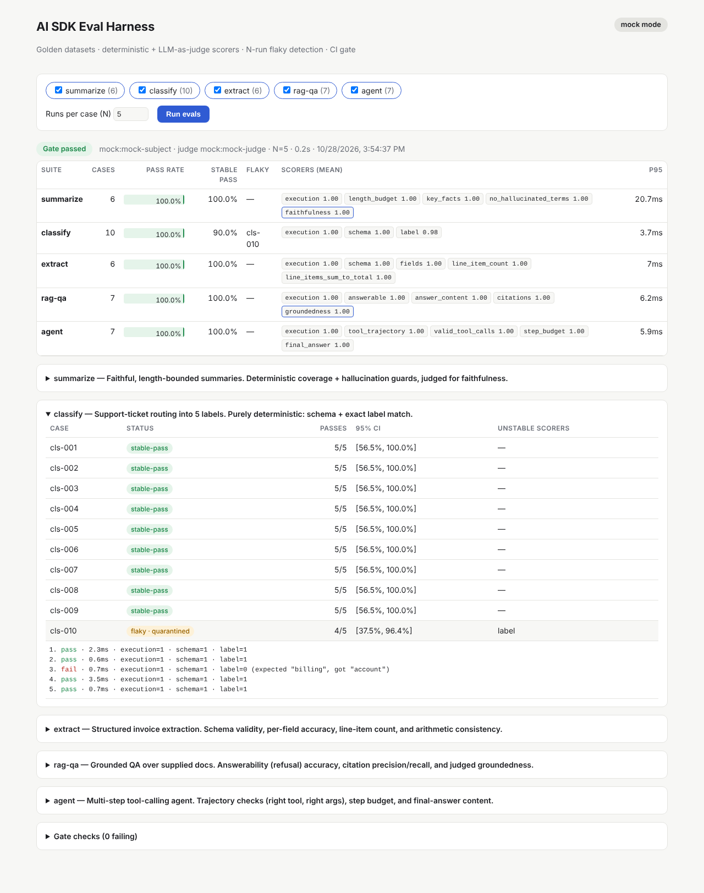

# ai-sdk-eval-harness

An evaluation harness for LLM features built with the [Vercel AI SDK](https://ai-sdk.dev) in a Next.js app.

It runs five feature suites against golden datasets and scores them with deterministic checks and an LLM judge. Every case runs N times, so flaky behaviour shows up as a measured pass rate instead of a surprise in production. A GitHub Actions gate blocks the merge when quality drops.

The harness runs fully offline by default. A deterministic mock model stands in for the LLM, so CI needs no API keys and gives the same result every time. Switch to `EVAL_MODE=live` to score real Anthropic or OpenAI models with the same suites.



## What's inside

| Piece | Where | What it does |
|---|---|---|
| Features under test | `src/lib/features/` | Five AI SDK v7 features: summarize, classify, extract, RAG-QA and a tool-calling agent, built on `generateText`, `Output.object` and `tool()` |
| Golden datasets | `evals/datasets/*.jsonl` | 36 hand-written cases, each validated by a Zod schema on load. A bad row fails with its file and line number |
| Deterministic scorers | `evals/scorers/deterministic.ts` | Exact match, contains-all, forbidden terms (word-boundary aware), length budget, schema validity, field accuracy with tolerance, tool-call trajectory, citation set match |
| LLM-as-judge | `evals/scorers/llm-judge.ts`, `src/lib/judge.ts` | 1–5 rubric through `Output.object` at temperature 0, normalised to 0..1. A judge error becomes a failing score, never a crashed run |
| Judge calibration | `evals/calibration/` | 20 human-labelled examples, half of them on the 2–4 boundary where judges disagree. Reports exact and within-±1 agreement, MAE, and Cohen's κ on the pass/fail decision with a bootstrap 95% CI. The judge must clear κ ≥ 0.6 before its scores count |
| N-run flaky detection | `evals/runner/run.ts`, `stats.ts` | Each case runs N times and gets a pass rate, a Wilson 95% interval, a stable-pass/stable-fail/flaky label, and the scorers that flipped. Provider errors (429, 5xx, timeouts) are counted separately and kept out of quality metrics |
| Gate | `evals/runner/gate.ts`, `evals/gate.config.json` | Per-suite and per-mode thresholds: pass rate, flaky rate, infra-error rate, judge score, suite regression and per-case regression against `evals/baselines/<mode>.json` |
| Gate self-test | `scripts/gate-selftest.ts` | Injects four realistic regressions into the mock and proves the gate fails on each one |
| Dashboard + API | `app/` | Next.js page and `POST /api/eval` for running suites and drilling into per-run results |
| Tests | `tests/unit` (Vitest), `tests/e2e` (Playwright) | 62 unit tests and 6 browser and API tests |
| CI | `.github/workflows/eval.yml` | Typecheck → Vitest → calibration → gate self-test → evals (N=5) → Playwright. Results go to the job summary and a sticky PR comment |

## The five suites

| Suite | Feature | Scorers |
|---|---|---|
| `summarize` | Length-bounded summary | length budget · key facts present · forbidden terms absent · **judge: faithfulness** |
| `classify` | Support-ticket routing (5 labels) | schema · exact label |
| `extract` | Invoice → typed JSON | schema · field accuracy · line-item count · line items sum to total |
| `rag-qa` | Answer from supplied docs, or refuse | answerability · answer content · citation set · **judge: groundedness** |
| `agent` | Multi-step tool use (calculator, weather, orders) | tool trajectory (name + args) · step budget · final answer |

The design rule: use a deterministic scorer whenever a property can be checked mechanically, and save the judge for what can't (faithfulness, groundedness).

## Quick start

```bash
npm ci
npm run eval              # all suites, N=5, mock mode, enforces the gate
npm run dev               # dashboard at http://localhost:3000
```

```bash
npm test                  # Vitest
npm run build && npm run test:e2e   # Playwright (run `npx playwright install chromium` once)
npm run eval:calibrate    # judge vs. human labels
npm run eval:gate-selftest
```

### CLI options

```bash
npm run eval -- --suite rag-qa,agent   # pick suites
npm run eval -- --runs 10              # N runs per case
npm run eval -- --only unanswerable    # filter by case id or tag
npm run eval -- --keep-outputs         # keep raw model outputs in the report
npm run eval -- --no-gate              # report only
npm run eval:baseline                  # re-record evals/baselines/<mode>.json (refuses if the gate fails or --only is set; --force overrides)
```

Every run writes `reports/latest.json` and `reports/summary.md`. Exit codes: `0` gate passed, `1` gate failed, `2` harness error.

### Live models

```bash
cp .env.example .env.local
EVAL_MODE=live EVAL_PROVIDER=anthropic ANTHROPIC_API_KEY=... npm run eval -- --runs 3
EVAL_MODE=live EVAL_PROVIDER=openai OPENAI_API_KEY=... EVAL_SUBJECT_MODEL=gpt-4.1-mini npm run eval
```

The subject and judge are set separately (`EVAL_SUBJECT_MODEL`, `EVAL_JUDGE_MODEL`). Set `EVAL_JUDGE_PROVIDER` to judge with a different model family than the one under test, which reduces self-preference bias; the report warns when they match. Run `npm run eval:calibrate` in live mode before trusting a new judge. In mock mode, calibration only checks the plumbing.

Live runs use their own baseline (`evals/baselines/live.json`), and regression checks are skipped when the baseline was recorded with different models. `gate.config.json` has a `modes.live` block that allows some flakiness, because real models at N=5 will show it.

In live mode, `POST /api/eval` needs `EVAL_API_ENABLED=true` and a bearer token matching `EVAL_API_TOKEN`. It allows one run at a time and caps each request at 120 executions, because it spends tokens.

## How flaky detection works

One run gives one bit per case. N runs give a pass rate, and the harness labels each case:

- **stable-pass**: passed all N runs
- **stable-fail**: failed all N runs (a real regression or a bad golden case)
- **flaky**: passed some runs and failed others

A flaky case gets a Wilson 95% interval, which stays honest at small N. At 4/5 passes the interval is roughly [38%, 96%], so one lucky run proves very little. The report also lists *which scorer* flipped, which tells you whether the instability is in the model's answer or in the judge.

Tag a case `known-flaky` to quarantine it. It still appears in every report but is left out of every gate check. In mock mode, any *new* flaky case fails the gate (`maxFlakyRate: 0`); live mode allows up to 20%.

Infrastructure failures (rate limits, 5xx, timeouts) are not quality failures. They are tagged `infra`, kept out of pass rates and flaky detection, and gated by their own `maxInfraErrorRate`. A case where every run hit one is `inconclusive`, not failing.

The mock includes one deliberately ambiguous ticket (`cls-010`, "charged twice … can't log in") that flips between `billing` and `account`. It proves the detector works: N=1 misses it, N=5 catches it.

## The gate

`evals/gate.config.json` sets the thresholds:

```json
{
  "defaults": { "minPassRate": 0.9, "maxFlakyRate": 0, "maxRegression": 0.05, "maxInfraErrorRate": 0.1, "minJudgeScore": 0.75 },
  "suites": { "summarize": { "minPassRate": 0.85 }, "extract": { "minPassRate": 0.95 } },
  "modes": { "live": { "maxFlakyRate": 0.2, "maxRegression": 0.1 } }
}
```

Overrides apply in order: defaults, then suite, then mode. With a compatible baseline, the gate also fails when any case that was `stable-pass` is now `stable-fail`, even if the suite's overall rate stays within tolerance.

A gate that never fails is worse than none, so CI also runs `eval:gate-selftest`. It injects four regressions into the mock (a hallucinated sentence, dropped citations, an agent that skips its tools, a malformed date) and asserts the gate blocks each one while a clean run passes.

## CI

`.github/workflows/eval.yml` runs on every PR and push to `main`:

1. **unit**: `tsc` and Vitest
2. **eval-gate**: judge calibration, gate self-test, then `eval:ci` (N=5). It uploads the report and posts a sticky PR comment
3. **e2e**: builds the app and runs Playwright against `next start`

A **live-eval** job runs on weekdays and on manual dispatch. It uses the `ANTHROPIC_API_KEY` or `OPENAI_API_KEY` repository secret, with optional `EVAL_PROVIDER`, `EVAL_JUDGE_PROVIDER`, `EVAL_SUBJECT_MODEL` and `EVAL_JUDGE_MODEL` repository variables. It skips cleanly when the key for the configured provider is missing, and it runs in its own concurrency group so a push never cancels it.

## Adding a suite

1. Write the feature in `src/lib/features/`.
2. Add `evals/datasets/<name>.jsonl` with golden cases.
3. Create `evals/suites/<name>.ts` with `defineSuite({ caseSchema, run, score })` and register it in `evals/suites/index.ts`.
4. Add a mock responder branch in `src/lib/mock/responders.ts` (keyed on the `Task:` line of the instructions) so CI can run it offline.
5. Set thresholds in `gate.config.json` and run `npm run eval:baseline`.

## Known limits

- 20 calibration items give a wide κ interval (the script prints it). Label 30–50 boundary cases before gating on a live judge.
- `extract`'s `line_items_sum_to_total` assumes invoices have no tax or shipping lines, which holds for the current fixtures.
- The mock responders are rule-based stand-ins. They test the harness, not model quality.

## Stack

Next.js 16 · AI SDK 7 (`ai`, `@ai-sdk/anthropic`, `@ai-sdk/openai`) · Zod 4 · Vitest 5 · Playwright · TypeScript · GitHub Actions
