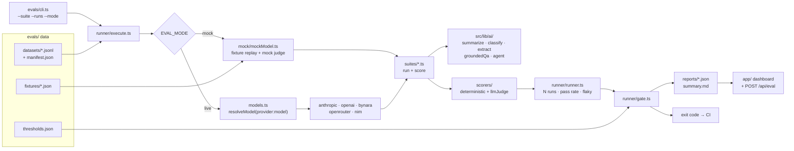

# ai-sdk-eval-harness

An evaluation harness for [Vercel AI SDK](https://ai-sdk.dev) features, built with Next.js 15 + AI SDK v6.
It runs five AI features against versioned golden datasets, scores them with deterministic checks and an
LLM-as-judge, repeats every case **N times** to detect flakiness, and gates CI on the result.

**Offline by default.** Without API keys, a fixture-replaying `MockLanguageModelV3` stands in for the
model and a deterministic mock judge stands in for the judge, so CI needs no secrets. Set `EVAL_MODE=live`
to hit real providers.

> The mock judge scores by reference-word coverage. It keeps the pipeline testable and deterministic;
> it is **not** a quality oracle. Trust live-mode numbers for model quality.

## Suites

| Suite | System under test (`src/lib/ai/`) | Scorers |
|---|---|---|
| `summarize` | `summarize` | keywords, length budget, LLM judge |
| `classify` | `classifyTicket` (structured) | schema validity, exact label |
| `extract` | `extractInvoice` (structured) | schema validity, exact fields, numeric tolerance |
| `rag` | `groundedQa` (grounded QA + citations + abstention) | schema, abstention, answer/citation contains, LLM judge (faithfulness) |
| `agent` | `runAgent` (tool calling, multi-step) | tool-call match (args, order), answer contains, length budget |

Each feature is a pure function `(model: LanguageModel, input) => result`, so the same code runs under a mock or a real model.

## Architecture



## Quick start

```bash
npm ci
npm test                 # unit tests (scorers, stats, runner, gate, datasets)
npm run eval             # run all suites offline (N=5), write reports/, apply the gate
npm run dev              # dashboard at http://localhost:3000
npm run e2e              # Playwright (builds the app, seeds reports first)
npm run eval:calibrate   # judge vs. human labels (kappa + bootstrap CI)
npm run eval:selftest    # proves the gate fails on injected regressions
npm run eval:baseline    # re-record evals/baselines/mock.json (refused if the gate fails)
```

Useful flags: `npm run eval -- --suite rag --suite agent --runs 10 --no-gate`.

### Live mode

```bash
cp .env.example .env     # set the API key for the provider you use
EVAL_MODE=live npm run eval -- --runs 3
```

`EVAL_MODEL` and `EVAL_JUDGE_MODEL` take `provider:model`. Only the first `:` separates the provider, so ids like `nvidia/...:free` work. Judges run at temperature 0 on a pinned model.

| Provider | Key env var | Endpoint (override env var) | Example spec |
|---|---|---|---|
| `anthropic` | `ANTHROPIC_API_KEY` | SDK default | `anthropic:claude-haiku-5-5` |
| `openai` | `OPENAI_API_KEY` | SDK default | `openai:<model>` |
| `bynara` | `BYNARA_API_KEY` | `https://router.bynara.id/v1` (`BYNARA_BASE_URL`) | `bynara:claude-haiku-5.5` |
| `openrouter` | `OPENROUTER_API_KEY` | `https://openrouter.ai/api/v1` (`OPENROUTER_BASE_URL`) | `openrouter:nvidia/nemotron-3-ultra-550b-a55b:free` |
| `nim` | `NVIDIA_API_KEY` | `https://integrate.api.nvidia.com/v1` (`NIM_BASE_URL`) | `nim:nvidia/nemotron-3-ultra-550b-a55b` |

`bynara`, `openrouter` and `nim` use an OpenAI-compatible chat-completions client. A bare id with a `/` and no provider prefix goes to Bynara; a bare id without one goes to Anthropic. Use the ids each provider lists (Bynara: `GET /v1/models`).

Notes from live runs:
- When every run errors, the CLI prints `N/total runs errored. First error: ...`. "The requested model does not exist" means the model id is wrong. "Bad Gateway" means the router could not reach the upstream model, so try another model.
- Free tiers (for example OpenRouter `:free` models) have daily request caps. One full run at N=5 makes about 200+ model calls (target + judge), so start with `--suite summarize --runs 1`.
- `classify`, `extract` and `rag` need structured output, and `agent` needs tool calling. Models without these will fail those suites even if `summarize` passes.

PowerShell:

```powershell
$env:EVAL_MODE = "live"
$env:EVAL_MODEL = "nim:nvidia/nemotron-3-ultra-550b-a55b"
$env:EVAL_JUDGE_MODEL = "nim:nvidia/nemotron-3-ultra-550b-a55b"
$env:NVIDIA_API_KEY = "<your key>"
npm run eval -- --suite summarize --runs 1 --no-gate
```

The dashboard's "Run suite" button and `POST /api/eval` use live providers only if the **server** has `EVAL_MODE=live`.

## How it works

- **Datasets** — `evals/datasets/<suite>.jsonl`, one Zod-validated case per line; `manifest.json` carries a version and each report records a content hash.
- **Scorers** — `evals/scorers/`: `exactMatch`, `contains`, `notContains`, `matchesRegex`, `schemaValid`, `numericTolerance`, `toolCallMatch`, `lengthBudget`, and `llmJudge` (rubric → structured 1–5 score + rationale via `generateObject`). A run passes only if **every** scorer passes; judge passes at ≥ 4/5 by default.
- **Runner** — `evals/runner/`: each case runs N times; reports pass rate, a Wilson 95% interval, mean score and σ per case, plus which scorers flipped between runs. A case is **flaky** when its pass rate is strictly between 0 and 1. Infrastructure errors (429, 5xx, timeouts) are tagged `infra` and kept out of pass rates and flaky detection; a case where every run hit one is `inconclusive`.
- **Mock replay** — `evals/fixtures/<suite>.json` maps case id → list of recorded responses; run *i* uses entry `i mod len`, which is how flaky behavior is reproduced deterministically. A fixture is text, a structured object, or `{steps: [...]}` for tool-calling agents.
- **Gate** — `evals/thresholds.json` sets `minPassRate`, `maxFlakeRate`, `maxInfraErrorRate` and `maxRegression` (defaults, then per-suite, then per-mode overrides) and an optional `quarantine` list of `suite/case` ids that are reported but not gated. The CLI exits non-zero when any suite misses.
- **Baseline regression** — `evals/baselines/<mode>.json` records pass rates and per-case stability for a model + dataset hash. The gate fails when a suite drops more than `maxRegression`, or when any case goes from always-passing to always-failing. Comparisons are skipped (with a note) when the mode, models or dataset changed, so a mock baseline never gates a live run.
- **Judge calibration** — `evals/calibration/` holds 20 human-labelled judge cases, half on the 2–4 boundary. `npm run eval:calibrate` reports agreement and Cohen's κ with a bootstrap interval; in live mode it fails below κ 0.6. The mock judge scores κ≈0.38, because coverage cannot see invented facts or credit correct abstentions. That is why it is treated as a plumbing check.
- **Gate self-test** — `EVAL_MOCK_FAULT` injects one realistic regression per suite into the fixture replay (truncated summaries, shifted labels, a misread total, dropped citations, an agent skipping tools). `npm run eval:selftest` asserts the clean gate passes and every fault fails it.

The committed fixtures deliberately include three flaky cases (`summarize/s05`, `extract/e04`, `rag/r06`) and one
always-failing case (`classify/c06`) so the flake detector and reports are exercised; the thresholds are set so the gate still passes.

## Adding a suite

1. Add `evals/suites/<name>.ts` (Zod case schema, `run`, `score`) and register it in `evals/suites/index.ts`.
2. Add `evals/datasets/<name>.jsonl`, a manifest entry, a `evals/fixtures/<name>.json`, and a threshold entry.
3. `tests/unit/datasets.test.ts` fails if any case lacks fixtures or a threshold is missing.

## CI (`.github/workflows`)

- `ci.yml`: lint → typecheck → Vitest → judge calibration (mock, report only) → gate self-test → eval gate (mock) → Playwright. Posts/updates a PR comment with the summary and uploads `reports/`.
- `live-eval.yml`: manual (`workflow_dispatch`) live run; needs the repo secret for each provider you pick (`ANTHROPIC_API_KEY`, `OPENAI_API_KEY`, `BYNARA_API_KEY`, `OPENROUTER_API_KEY`, `NVIDIA_API_KEY`). Endpoints can be overridden with the `BYNARA_BASE_URL`, `OPENROUTER_BASE_URL` and `NIM_BASE_URL` repo variables.

Over HTTP, `POST /api/eval` is open in mock mode. In live mode it needs `EVAL_API_ENABLED=true` and a bearer token matching `EVAL_API_TOKEN`, and runs one suite at a time.

To make the gate block merges, mark the `checks` and `e2e` jobs as required in branch protection.
