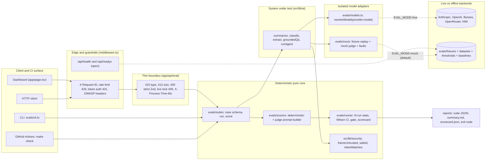

# ai-sdk-eval-harness

[](https://github.com/AshraHossain/ai-sdk-eval-harness/actions/workflows/ci.yml)


[](LICENSE)

An evaluation harness for [Vercel AI SDK](https://ai-sdk.dev) features, built with Next.js 15 + AI SDK v6.
It runs five AI features against versioned golden datasets, scores them with deterministic checks and an
LLM-as-judge, repeats every case **N times** to detect flakiness, and gates CI on the result.

**Offline by default.** Without API keys, a fixture-replaying `MockLanguageModelV3` stands in for the
model and a deterministic mock judge stands in for the judge, so CI needs no secrets. Set `EVAL_MODE=live`
to hit real providers.

> The mock judge scores by reference-word coverage. It keeps the pipeline testable and deterministic;
> it is **not** a quality oracle. Trust live-mode numbers for model quality.

## Suites

| Suite | System under test (`src/lib/ai/`) | Scorers |
|---|---|---|
| `summarize` | `summarize` | keywords, length budget, LLM judge |
| `classify` | `classifyTicket` (structured) | schema validity, exact label |
| `extract` | `extractInvoice` (structured) | schema validity, exact fields, numeric tolerance |
| `rag` | `groundedQa` (grounded QA + citations + abstention) | schema, abstention, answer/citation contains, LLM judge (faithfulness) |
| `agent` | `runAgent` (tool calling, multi-step) | tool-call match (args, order), answer contains, length budget |

Each feature is a pure function `(model: LanguageModel, input) => result`, so the same code runs under a mock or a real model.

## Architecture

Requests pass through edge guardrails and a thin route into a deterministic core. Only the model adapter
knows whether it is talking to a real provider or to recorded fixtures. Design rules, the module map and
metric definitions are in [ARCHITECTURE.md](ARCHITECTURE.md).

### Layered system architecture



### End-to-end request sequence

```mermaid
sequenceDiagram
    autonumber
    actor C as Client
    participant MW as middleware.ts
    participant R as POST /api/eval
    participant X as executeSuite
    participant M as Model (fixture or live)
    participant S as Scorers + judge
    participant G as Runner, gate, scorecard
    participant FS as reports/

    rect rgb(235, 242, 255)
    Note over C,MW: Edge guardrails
    C->>MW: POST /api/eval with JSON body
    MW->>MW: Request id, sliding-window rate limit, optional token check
    alt over limit or bad token
        MW-->>C: 429 with Retry-After 60, or 401
    end
    MW->>R: Forward with X-Request-ID
    R->>R: Content-Type 415, byte cap 413, strict Zod 400
    end

    rect rgb(236, 248, 238)
    Note over R,G: Deterministic eval run
    R->>X: suite, runs, mode
    loop each case, N runs
        X->>M: Feature prompt with untrusted text framed
        M-->>X: Text, object or tool calls
        X->>S: Score output (code checks, then judge if needed)
        S-->>X: ScoreResult list
    end
    X->>G: Pass rate, Wilson CI, flaky cases, latency
    G->>FS: safeId suite JSON
    end

    R-->>C: 200 summary with X-Process-Time-Ms and OWASP headers

## Scorecard

Offline (mock) run, N=5 runs per case, from `npm run eval:gate` (`reports/scorecard.json`):

| Metric | Value | What it measures |
|---|---|---|
| Pass rate (mean of suites) | 94.7% | A run passes only if every scorer passes |
| Citation recall (Recall@k, rag) | 100.0% | Expected document ids found in the returned citations |
| Grounding rate (rag) | 100.0% | Faithfulness judge passes (mock judge: reference coverage) |
| Guardrail pass rate (rag) | 95.0% | Correct abstention when documents lack the answer; seeded flaky case `rag/r06` |
| Tool-call accuracy (agent) | 100.0% | Right tools, args and order |
| Latency p50 / p95 per run | 0 ms / 2 ms | Harness overhead only in mock mode |

| Suite | Pass rate | Flaky cases | Gate |
|---|---|---|---|
| summarize | 96.7% | 1/6 (`s05`) | ✅ |
| classify | 83.3% | 0/6 (`c06` always fails, by design) | ✅ |
| extract | 96.7% | 1/6 (`e04`) | ✅ |
| rag | 96.7% | 1/6 (`r06`) | ✅ |
| agent | 100.0% | 0/6 | ✅ |

These numbers come from fixtures that include seeded failures, so they show that the harness and gate
work. They say nothing about model quality. Run `EVAL_MODE=live npm run eval` for that.

### Live run: Gemini 3.8 Flash on Vertex AI

`EVAL_MODEL=vertex:gemini-3.8-flash`, same model as judge, N=3 runs per case, run on 2026-11-17. Gate: **PASSED**.

| Suite | Pass rate | Flaky cases | Gate |
|---|---|---|---|
| summarize | 88.9% | 1/6 (`s01`) | ✅ |
| classify | 100.0% | 0/6 | ✅ |
| extract | 100.0% | 0/6 | ✅ |
| rag | 100.0% | 0/6 | ✅ |
| agent | 100.0% | 0/6 | ✅ |

| Metric | Value |
|---|---|
| Pass rate (mean of suites) | 97.8% |
| Citation recall / grounding / guardrail (rag) | 100% / 100% / 100% |
| Tool-call accuracy (agent) | 100.0% |
| Latency p50 / p95 per run (including judge calls) | 3988 ms / 9912 ms |

What the run found:
- `summarize/s01` is flaky. The model writes "rolled it back" and the keyword scorer wants the
  phrase "rolled back". The keyword scorer is strict on wording, which a real model shows and the
  fixtures do not.
- The first attempt went through Vertex's OpenAI-compatible endpoint, and the agent suite failed 5 of 6
  cases with HTTP 400. Gemini 3 tool calls carry a `thought_signature` that must be sent back on the
  next step, and the OpenAI client drops it. `vertex:` now uses the native client.

Limits: one model, N=3, and the model judges its own output (self-preference bias is possible). Treat
this as a smoke test of a real provider, not a benchmark.

## Quick start

```bash
npm ci
make check               # lint + types + tests (per-file 80% coverage) + gate self-test + eval gate
npm test                 # unit tests (scorers, stats, runner, gate, datasets)
npm run eval             # run all suites offline (N=5), write reports/, apply the gate
npm run dev              # dashboard at http://localhost:3000
npm run e2e              # Playwright (builds the app, seeds reports first)
npm run eval:calibrate   # judge vs. human labels (kappa + bootstrap CI)
npm run eval:selftest    # proves the gate fails on injected regressions
npm run eval:baseline    # re-record evals/baselines/mock.json (refused if the gate fails)
docker compose up --build   # dashboard + API on :3000, non-root, read-only rootfs
```

Useful flags: `npm run eval -- --suite rag --suite agent --runs 10 --no-gate`.

### Live mode

```bash
cp .env.example .env     # set the API key for the provider you use
EVAL_MODE=live npm run eval -- --runs 3
```

`EVAL_MODEL` and `EVAL_JUDGE_MODEL` take `provider:model`. Only the first `:` separates the provider, so ids like `nvidia/...:free` work. Judges run at temperature 0 on a pinned model.

| Provider | Key env var | Endpoint (override env var) | Example spec |
|---|---|---|---|
| `anthropic` | `ANTHROPIC_API_KEY` | SDK default | `anthropic:claude-haiku-5-5` |
| `openai` | `OPENAI_API_KEY` | SDK default | `openai:<model>` |
| `bynara` | `BYNARA_API_KEY` | `https://router.bynara.id/v1` (`BYNARA_BASE_URL`) | `bynara:claude-haiku-5.5` |
| `openrouter` | `OPENROUTER_API_KEY` | `https://openrouter.ai/api/v1` (`OPENROUTER_BASE_URL`) | `openrouter:nvidia/nemotron-3-ultra-550b-a55b:free` |
| `nim` | `NVIDIA_API_KEY` | `https://integrate.api.nvidia.com/v1` (`NIM_BASE_URL`) | `nim:nvidia/nemotron-3-ultra-550b-a55b` |
| `vertex` | ADC (`gcloud auth application-default login`) + `GOOGLE_CLOUD_PROJECT` | native Vertex client; `GOOGLE_CLOUD_LOCATION` (default `global`) | `vertex:gemini-3.8-flash` |

`bynara`, `openrouter` and `nim` use an OpenAI-compatible chat-completions client. `vertex` uses the native `@ai-sdk/google-vertex` client, because Gemini 3 tool calls carry thought signatures that the OpenAI-compatible endpoint drops. A bare id with a `/` and no provider prefix goes to Bynara; a bare id without one goes to Anthropic. Use the ids each provider lists (Bynara: `GET /v1/models`).

Notes from live runs:
- When every run errors, the CLI prints `N/total runs errored. First error: ...`. "The requested model does not exist" means the model id is wrong. "Bad Gateway" means the router could not reach the upstream model, so try another model.
- Free tiers (for example OpenRouter `:free` models) have daily request caps. One full run at N=5 makes about 200+ model calls (target + judge), so start with `--suite summarize --runs 1`.
- `classify`, `extract` and `rag` need structured output, and `agent` needs tool calling. Models without these will fail those suites even if `summarize` passes.

PowerShell:

```powershell
$env:EVAL_MODE = "live"
$env:EVAL_MODEL = "nim:nvidia/nemotron-3-ultra-550b-a55b"
$env:EVAL_JUDGE_MODEL = "nim:nvidia/nemotron-3-ultra-550b-a55b"
$env:NVIDIA_API_KEY = "<your key>"
npm run eval -- --suite summarize --runs 1 --no-gate
```

The dashboard's "Run suite" button and `POST /api/eval` use live providers only if the **server** has `EVAL_MODE=live`.

## How it works

- **Datasets** — `evals/datasets/<suite>.jsonl`, one Zod-validated case per line; `manifest.json` carries a version and each report records a content hash.
- **Scorers** — `evals/scorers/`: `exactMatch`, `contains`, `notContains`, `matchesRegex`, `schemaValid`, `numericTolerance`, `toolCallMatch`, `lengthBudget`, and `llmJudge` (rubric → structured 1–5 score + rationale via `generateObject`). A run passes only if **every** scorer passes; judge passes at ≥ 4/5 by default.
- **Runner** — `evals/runner/`: each case runs N times; reports pass rate, a Wilson 95% interval, mean score and σ per case, plus which scorers flipped between runs. A case is **flaky** when its pass rate is strictly between 0 and 1. Infrastructure errors (429, 5xx, timeouts) are tagged `infra` and kept out of pass rates and flaky detection; a case where every run hit one is `inconclusive`.
- **Mock replay** — `evals/fixtures/<suite>.json` maps case id → list of recorded responses; run *i* uses entry `i mod len`, which is how flaky behavior is reproduced deterministically. A fixture is text, a structured object, or `{steps: [...]}` for tool-calling agents.
- **Gate** — `evals/thresholds.json` sets `minPassRate`, `maxFlakeRate`, `maxInfraErrorRate` and `maxRegression` (defaults, then per-suite, then per-mode overrides) and an optional `quarantine` list of `suite/case` ids that are reported but not gated. The CLI exits non-zero when any suite misses.
- **Baseline regression** — `evals/baselines/<mode>.json` records pass rates and per-case stability for a model + dataset hash. The gate fails when a suite drops more than `maxRegression`, or when any case goes from always-passing to always-failing. Comparisons are skipped (with a note) when the mode, models or dataset changed, so a mock baseline never gates a live run.
- **Judge calibration** — `evals/calibration/` holds 20 human-labelled judge cases, half on the 2–4 boundary. `npm run eval:calibrate` reports agreement and Cohen's κ with a bootstrap interval; in live mode it fails below κ 0.6. The mock judge scores κ≈0.38, because coverage cannot see invented facts or credit correct abstentions. That is why it is treated as a plumbing check.
- **Gate self-test** — `EVAL_MOCK_FAULT` injects one realistic regression per suite into the fixture replay (truncated summaries, shifted labels, a misread total, dropped citations, an agent skipping tools). `npm run eval:selftest` asserts the clean gate passes and every fault fails it.

The committed fixtures deliberately include three flaky cases (`summarize/s05`, `extract/e04`, `rag/r06`) and one
always-failing case (`classify/c06`) so the flake detector and reports are exercised; the thresholds are set so the gate still passes.

## Adding a suite

Follow [.claude/skills/add-eval-suite/SKILL.md](.claude/skills/add-eval-suite/SKILL.md). In short: a pure feature in
`src/lib/ai/`, a suite in `evals/suites/` registered in `index.ts`, dataset + manifest entry + fixtures, a fault in
`evals/mock/faults.ts`, then `make check`. `tests/unit/datasets.test.ts` fails if any case lacks fixtures.

## Security

Details and the full threat table: [SECURITY.md](SECURITY.md).

- **Edge** (`middleware.ts`, Node runtime, `/api/*`): `X-Request-ID`, sliding-window rate limit (`RATE_LIMIT_PER_MINUTE`,
  default 120, 429 + `Retry-After: 60`; per client only via `TRUSTED_PROXY_HOPS`, forged `X-Forwarded-For` ignored), optional `API_AUTH_TOKEN` (Bearer or `X-API-Key`, constant-time compare, 401),
  and `nosniff`, `X-Frame-Options: DENY`, `Referrer-Policy: no-referrer`, `Cache-Control: no-store`,
  `Content-Security-Policy: default-src none; frame-ancestors none`. `/api/health` and `/api/readyz` stay open.
- **Route**: JSON only (415), 4 KB cap (413), strict schema (400), `X-Process-Time-Ms`, generic 500s. Live runs also need
  `EVAL_API_ENABLED=true` + `EVAL_API_TOKEN` and run one at a time (409).
- **Prompts**: documents, tickets and invoices reach the model inside `<untrusted_context>` boundaries with boundary tags and
  control characters stripped. Report paths use an allowlisted `safeId()`.
- **Lint**: `eslint-plugin-security` with zero warnings allowed. **Container**: UID 10001, read-only rootfs, all caps dropped.

## CI (`.github/workflows`)

- `ci.yml`: judge calibration (mock, report only) → `make check` (lint, typecheck, Vitest with the per-file coverage gate, gate self-test, eval gate) → Playwright e2e → Docker build that waits for the `HEALTHCHECK` and checks the non-root user. Posts or updates a PR comment with the summary, writes coverage to the job summary and uploads `reports/`.
- `live-eval.yml`: manual (`workflow_dispatch`) live run; needs the repo secret for each provider you pick (`ANTHROPIC_API_KEY`, `OPENAI_API_KEY`, `BYNARA_API_KEY`, `OPENROUTER_API_KEY`, `NVIDIA_API_KEY`). Endpoints can be overridden with the `BYNARA_BASE_URL`, `OPENROUTER_BASE_URL` and `NIM_BASE_URL` repo variables.

Over HTTP, `POST /api/eval` is open in mock mode unless `API_AUTH_TOKEN` is set. In live mode it also needs `EVAL_API_ENABLED=true` and a bearer token matching `EVAL_API_TOKEN`, and runs one suite at a time.

To make the gate block merges, mark the `checks`, `e2e` and `docker` jobs as required in branch protection.
